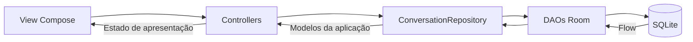

# DroidMentor

## Group Members
### Turma - 53D

- Kauã Borges - 52790
- Jaime Marques - 52683 
- Tiago Neto - 52777

## Testes da API Gemini

Testes locais com respostas simuladas, sem chave nem acesso à rede:

```powershell
.\gradlew.bat :app:testDebugUnitTest --tests api.GeminiAPITest
```

Testes de integração com pedidos reais (consomem quota da API):

```powershell
.\gradlew.bat :app:testDebugUnitTest --tests api.GeminiAPILiveTest -PgeminiLiveTests=true
```

Os testes reais leem `GEMINI_KEY` de `app/DroidMaster.env` ou, se não existir, de
`DroidMaster.env` na raiz. A chave não é incluída no APK nem impressa pelos testes.
Os testes reais estão ativados em `gradle.properties` com `geminiLiveTests=true`,
incluindo quando executados pelo Android Studio através do Gradle. Para os
ignorar numa execução, usa `-PgeminiLiveTests=false`. O modelo usado por
defeito é o definido em `GeminiAPI.kt` (`gemini-3.8-flash`). Pode ser indicado outro modelo com
`-PgeminiModel=nome-do-modelo`.

Os testes reais verificam respostas sobre Android, a continuidade do contexto e a receção HTTP 200/201. Os testes simulados verificam também o tratamento dos códigos HTTP de erro, respostas sem texto e cancelamento.

Para executar apenas os dois testes adicionais de contexto e receção HTTP:

```powershell
.\gradlew.bat :app:testDebugUnitTest --tests api.GeminiAPILiveTest.continuesConversationUsingPreviousAndCurrentUserMessages --tests api.GeminiAPILiveTest.receivesHttp200Or201AndDeserializesAnswer -PgeminiLiveTests=true
```

O primeiro valida duas interações reais: a resposta final deve recuperar um nome
de Activity aleatório do histórico e combinar a quantidade inicial de tarefas
com a alteração pedida na mensagem atual. O segundo verifica o HTTP 200/201 real
e o texto recebido e desserializado por `GeminiAPI`. Estes dois testes usam um
timeout de 180 segundos por pedido; o cliente da aplicação mantém 60 segundos.
Falhas HTTP, timeouts e respostas incorretas fazem os testes falhar.


## Relatório de arquitetura e persistência local — 2026-11-02

Esta etapa implementa o armazenamento local e a ligação aos controllers. Não
inclui chamadas ao Gemini nem a configuração da API Key. A arquitetura mantém
MVC conforme a orientação atual de `PROJECT_PLANNED.md`.

### Problemas identificados e correções

| Problema encontrado | Consequência | Correção nesta etapa |
|---|---|---|
| Mistura de `androidx.room` e `androidx.room3`, sem compilador Room | A compilação Kotlin não garantia a geração/validação da base de dados | Room **2.8.5**, runtime e compiler da mesma versão, processados por **KSP**; esquema exportado em `app/schemas` |
| UUID com `autoGenerate = true` | Identificador incompatível com a geração automática de inteiros | UUID da conversa criado pela aplicação e persistido como `String`; identificador interno numérico nas mensagens |
| `insert` devolvia UUID; datas e campos divergiam entre entidades e modelos | Contratos dos DAOs e conversões inconsistentes | Inserções devolvem `Unit`, datas usam `Long` e o repositório converte entidades em modelos |
| Ordenação apenas por `timestamp` | Mensagens no mesmo milissegundo podiam trocar de posição | Sequência `messageOrder` por conversa, com índice único e atribuição dentro de uma transação |
| Históricos mantidos exclusivamente em mapas/listas dos controllers | Perda dos dados após encerramento do processo | Room passa a ser a fonte dos dados; controllers observam os `Flow` do repositório |
| `currentConversationId != Uuid` e UUID criado antes de existir uma conversa | Mensagens podiam referenciar uma conversa ausente do histórico | Seleção inicial `null`; a conversa e a primeira mensagem são inseridas atomicamente |
| Possibilidade de duplo envio e de conclusão de gravação após navegar | Duplicação ou seleção inesperada de uma conversa antiga | Estado `isSending` e verificação da versão da seleção antes de alterar a conversa ativa |
| View de partilha recebia `MessageDao` | A interface conhecia detalhes de persistência | `SharedButton` recebe `SharedController`; a consulta paginada passa pelo repositório |
| Escrita de ficheiros na thread da interface e nome temporário fixo | Risco de bloqueio e sobrescrita entre partilhas | Escrita em `Dispatchers.IO`, ficheiros temporários únicos e erro explícito se o destino não abrir |
| Duas implementações de exportação Markdown e navegação de regresso sem atribuição | Duplicação e botão de regresso sem efeito | Exportação reutiliza a mesma conversão; regresso atualiza `currentScreen` |

O antigo texto automático "Mensagem recebida" foi removido do envio. Nesta fase,
o envio guarda apenas a mensagem do utilizador, sem inventar uma resposta da IA.
O repositório já aceita mensagens com `Author.MODEL` para uma integração posterior.

### Fluxo implementado



`DroidMasterApplication` fornece a base de dados, o repositório e os controllers
por injeção manual, sem Hilt/Dagger. O scope dos controllers pertence à aplicação
e usa `SupervisorJob` e `Dispatchers.Main.immediate`; Room executa as consultas
suspensivas fora da thread da interface. Os controllers não conhecem DAOs, SQL ou
entidades. Cada conversa guarda uma sequência própria de mensagens.

A versão 1 é o primeiro esquema Room efetivamente gerado nesta implementação.
Não foi adicionada uma estratégia de eliminação destrutiva da base de dados.
Alterações futuras ao esquema exigem incrementar a versão e criar/testar uma
migração; não se deve apagar o histórico para resolver incompatibilidades.

### Validação local

Os testes usam o código gerado pela Room em SQLite com Robolectric, sem emulador,
e repositórios de teste para controlar falhas e operações pendentes dos controllers.
São verificados persistência após reabrir o ficheiro, transações, chaves estrangeiras,
ordenação, inserções concorrentes, paginação/exportação, criação e isolamento de
conversas, duplo envio e navegação durante uma gravação.

```powershell
.\gradlew.bat :app:assembleDebug
.\gradlew.bat :app:testDebugUnitTest --tests 'storage.*' --tests 'controller.*' --tests api.GeminiAPITest '-PgeminiLiveTests=false'
```

Resultado: **16 testes locais aprovados**, sem falhas nem testes ignorados: 7 testes Room/repositório, 5 dos controllers e 4 da API com respostas simuladas. O KSP gerou a base de dados, os DAOs e o esquema da versão 1. A compilação `:app:assembleDebug` também foi verificada.
Os testes reais da IA estão excluídos deste comando.

### Trabalho ainda pendente

- API Key e configurações em DataStore; o ficheiro `.env` continua a ser apenas uma entrada dos testes locais.
- Integração da IA com o repositório, conectividade, estados de geração e tratamento de falhas de rede/HTTP.
- Contrato comum de mensagens para `AIProvider`, atualmente dependente dos DTOs Gemini, antes de adicionar outros fornecedores.
- Expiração de mensagens/conversas e identificação do fornecedor de cada resposta, previstas nas adendas.
- Política de retenção dos ficheiros temporários de partilha.
- Exportação de um instantâneo consistente se forem permitidas eliminações durante a paginação.
- Estado de navegação/rascunho após morte do processo: o histórico é persistente, mas o ecrã ativo e o rascunho ainda não são restaurados.

## MVC ou MVVM neste projeto?

### Decisão para esta etapa

**Manter MVC nesta implementação**, porque o plano atual define esse padrão e já
existem controllers e Views construídos em torno dele. Os problemas de persistência
identificados não exigem uma mudança para MVVM: exigem contratos corretos, uma fonte
de dados persistente e separação entre interface, coordenação e armazenamento.
Esta é uma decisão de âmbito do projeto; não é uma afirmação de que MVC seja a
opção técnica preferível para toda a evolução de uma aplicação Android.

### Comparação

| Critério | MVC atual com repositório | MVVM com ViewModel |
|---|---|---|
| Adequação ao plano | Corresponde ao MVC definido em `PROJECT_PLANNED.md` | Exigiria atualizar o plano e a responsabilidade da camada de apresentação |
| Estado em Compose | Controllers expõem estado observável e recebem ações | ViewModel expõe estado imutável, frequentemente por `StateFlow` |
| Ciclo de vida | Scope e duração dos controllers geridos manualmente na `Application` | `ViewModel` e `viewModelScope` acompanham o ciclo de vida do ecrã/owner |
| Rotação e navegação | Controllers de aplicação sobrevivem à recriação da Activity, mas não têm isolamento por ecrã | ViewModels podem ser associados a uma Activity ou destino de navegação |
| Morte do processo | Room preserva dados; restauração do estado transitório exige trabalho próprio | `SavedStateHandle` ajuda a restaurar estado pequeno; Room continua necessário para o histórico |
| Testes | Injeção do repositório e scope permite testar controllers sem rede | Mesma separação de dados, com testes de ViewModels e dispatchers controlados |
| Complexidade nesta etapa | Menor alteração à estrutura existente | Migração acrescenta trabalho sem corrigir automaticamente o esquema/DAOs |
| Evolução com vários estados assíncronos | É necessário manter disciplina na gestão manual de jobs/estado | Encaixa melhor com estado reativo, geração, erros, seleção e cancelamento por ecrã |

**Se a escolha fosse livre para uma nova aplicação Android em Compose, a recomendação
seria MVVM com ViewModel, repositório e fluxo unidirecional de estado.** Esta conclusão
é uma avaliação para este projeto, apoiada nas recomendações Android sobre ViewModels,
repositórios e recolha de estado com respeito pelo ciclo de vida. Não significa que
basta mudar o nome `Controller` para `ViewModel`.

Para uma migração futura: manter Room/repositório/modelos, mover o estado de
apresentação e as ações para ViewModels, trocar o scope de aplicação por
`viewModelScope` onde apropriado e recolher `StateFlow` na View com respeito pelo
ciclo de vida. A lógica de base de dados e os seus testes não precisam de ser refeitos.

### Referências da análise

- [Recomendações oficiais de arquitetura Android](https://developer.android.com/topic/architecture/recommendations)
- [ViewModel e ciclo de vida](https://developer.android.com/topic/libraries/architecture/viewmodel)
- [Operações assíncronas e Flow na Room](https://developer.android.com/training/data-storage/room/async-queries)
- [Versões da Room](https://developer.android.com/jetpack/androidx/releases/room)
- [KSP](https://github.com/google/ksp/releases)
- [Testes locais com Robolectric](https://robolectric.org/getting-started/)


## Segurança da partilha e dos backups

- O `FileProvider` disponibiliza apenas `cache/shared_conversations/`. Os ficheiros Markdown são criados nessa pasta, com nomes únicos, e o intent concede apenas leitura ao destinatário escolhido.
- O botão de partilha aparece no ecrã de conversa quando existe uma conversa guardada; abre o seletor Android com o ficheiro Markdown completo. O conteúdo das mensagens é mantido sem alterações.
- A base de dados `droidmaster.db` e os ficheiros `-wal`/`-shm` são excluídos dos backups automáticos e da transferência automática entre dispositivos. O histórico continua disponível no dispositivo atual; para o transportar, é necessário partilhá-lo/exportá-lo. Backups antigos não são apagados por esta configuração.
- O teste local de SQL verifica que texto semelhante a uma injeção continua a ser tratado como dado. O teste no emulador verifica a partilha, a rejeição de ficheiros fora da pasta e as regras de backup.
- Os ficheiros temporários são mantidos na cache para permitir a leitura assíncrona pela aplicação destinatária. Continua pendente uma política de eliminação posterior; a cache pode ser limpa pelo sistema.
